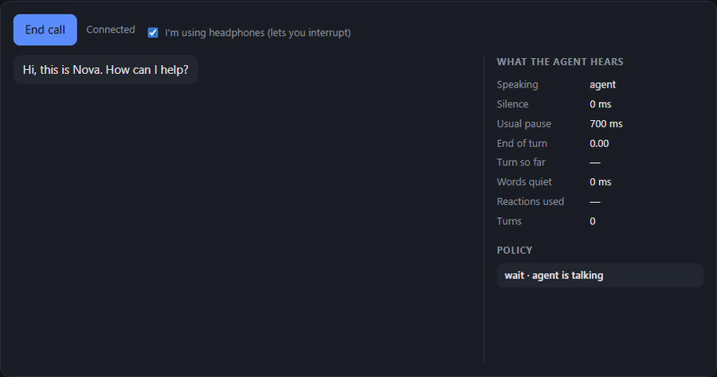
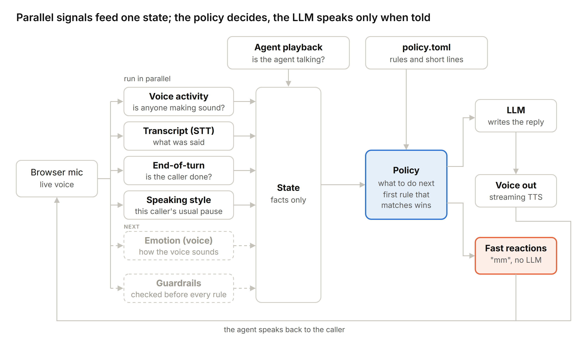

# Beyond Words

[](https://github.com/ismailalshofi/beyond-words-voice-agent/actions/workflows/ci.yml)

**A real-time voice agent that listens to how you say something, not only what you say.**

The way I see it, most voice agents today are a text bot with a microphone and a speaker attached. The user speaks, the system turns it into text, an LLM answers, and the answer is read out loud. Everything about how the user said it is lost: the tone, the pauses, how long they stayed quiet, whether they stopped because they finished or because they are still thinking.

I started by imagining one call, second by second, and asking at every moment: who handles this? The user pauses for two seconds. They say "yeah" while the agent talks. They talk over the agent. They go quiet. Every one of these is a design problem, and each one became a part of this system.

The short version: signals from the audio run next to the transcript and go into one **state**. A **policy** in the middle decides what the agent does, and only then does the LLM speak.



*The panel next to the transcript shows what the agent hears and every decision of the policy. The caller stops mid-sentence ("a table for…"), so the agent says "mm" instead of answering. When the sentence is done, it answers. When the caller cuts in with two words, it stops. This recording replays a scripted caller through the real listener and `policy.toml` with a fake clock, so the timings are the policy's own.*

---

## The big picture



The boxes on the left run all the time during the call. They don't decide anything, they only report what they see. The state keeps the latest facts. The policy is the main part, because it sits in the middle and it is what drives the agent. The dashed boxes are next on the list.

## What the agent listens to

| Module | What it reports | How |
|---|---|---|
| **Voice activity** | Is the caller making sound right now | Energy over the background noise, on the raw 100 ms frames. It runs locally, so it knows the caller stopped ~300 ms before the STT does |
| **Transcript** | The words, while the caller is still talking | Deepgram streaming (or ElevenLabs Scribe), interim and final results |
| **End of turn** | How likely it is the caller finished | From the words: *"What time do you open?"* is finished, *"So I was thinking that"* is not. A small stand-in behind one interface, so a semantic model (Deepgram Flux, LiveKit's turn detector) can replace it |
| **Speaking style** | This caller's usual pause in the middle of a turn | The median of their real pauses. Every timing rule is measured against it |

The silence is counted from the moment the last person stopped talking. It keeps adding up, it does not reset on every read.

## The state

One snapshot of the call right now. Facts only, no decisions. The live panel in the UI shows it during a call.

```json
{
  "call_ms": 41200,
  "turns": 6,
  "agent_speaking": false,
  "user_speaking": false,
  "silence_ms": 1200,
  "baseline_pause_ms": 700,
  "pending_text": "So I was thinking that",
  "interim_text": "",
  "end_of_turn": 0.15,
  "words_quiet_ms": 1400,
  "unheard_speech_ms": 0,
  "reactions": []
}
```

How I read it: the caller stopped in the middle of a sentence, and has been quiet for 1.2 s. Their normal pause is 0.7 s, so this is longer than usual, but the sentence isn't finished. The state does not say what to do with this. That is the job of the policy.

## The policy

The policy reads the state about 10 times a second and decides how the agent reacts: when to speak, when to listen, when to say "mm", when to call the LLM. It is rule-based code, so it is fast, it is the same every time, and it can be tested.

The rules live in [`policy.toml`](policy.toml). The first rule that matches wins:

| # | If | Then |
|---|---|---|
| 1 | the caller says 2+ words while the agent is talking | stop the agent right away |
| 2 | the agent is talking | wait |
| 3 | the STT stopped giving words for 3 s (noise keeps the mic "on") | answer |
| 4 | the caller is talking | wait |
| 5 | the mic heard a voice but the STT got no words | "Sorry, I missed that" |
| 6 | nobody talked for 8 s | "Take your time." |
| 7 | there is nothing to answer | wait |
| 8 | silence is shorter than the caller's usual pause | wait |
| 9 | the caller finished (end of turn ≥ 0.7) | answer |
| 10 | the sentence isn't finished, silence ≥ 1.5 × usual pause | soft "mm", no LLM |
| 11 | silence ≥ 3 × usual pause | answer anyway |

On the state above: silence is 1.2 s against a usual pause of 0.7 s, and the sentence isn't finished. So rule 10 matches: the agent says a soft "mm" and keeps listening. No LLM call, so the reaction is fast and costs nothing.

A "yeah" from the caller while the agent talks is not an interruption (rule 1 needs two words), and it doesn't become a new turn either: it is dropped when the agent finishes.

### Policy or prompt: who decides what

I split it with one simple test. If the rule is about **when or whether** the agent speaks, it lives in the policy. If it is about **how a sentence sounds**, it lives in the prompt.

| | Policy (code) | Prompt (LLM) |
|---|---|---|
| Decides | when to speak, what kind of reaction | the words and the style of the reply |
| Example | "say mm after 1.5 × the usual pause" | "short sentences, no lists, say numbers out loud" |
| Can it be broken? | no, it is code | yes, the LLM can still ignore it |

A rule can also guide the LLM for one reply with a `guidance` line, which is added to the prompt only when that rule decides to answer.

## Two kinds of delay

I don't use one latency number. Answering too early is often worse than answering a bit late: if the caller is still thinking and the agent jumps in after 400 ms, it feels rude. So the delay is split in two:

| Kind | Examples | Target |
|---|---|---|
| **Fast reactions** | "mm-hmm", "take your time", stopping when interrupted. No LLM | under 300 ms |
| **Full replies** | policy → LLM → voice | first audio ~800–1200 ms after the policy decides |

Fast reactions play from **clips**: the short lines in `policy.toml` are rendered once at call start, in the agent's own voice, on a separate TTS connection. They play at once and never queue behind a real reply.

For full replies, everything streams: the first TTS chunk goes out after about 3 words, the voice starts before the LLM has finished, and the TTS socket is pre-warmed so the handshake is off the critical path. When the call ends, the server prints the delay of each step for every turn, and saves the call's events to `calls/` as JSON.

## Remembering what the caller actually heard

The text the LLM wrote is not what the caller heard. TTS is faster than real time, so most of a reply can be generated and sent before the caller has heard the first sentence. If they interrupt, a naive agent keeps the whole reply in history and later refers to things the caller never heard.

Here a reply only goes into history when the browser reports it finished playing, or when the caller interrupts it. On an interruption, the server estimates how far playback got and uses the character timings ElevenLabs sends with each audio chunk to keep only the words that were heard ([`spoken_timeline.py`](app/voice/spoken_timeline.py)).

## Failure handling

Every part can fail, so every part gets a safe default. The caller should never hear a dead line or a crash.

| What fails | What the agent does |
|---|---|
| The LLM is slow (no token after 1.5 s) | says "One moment." so the line isn't silent |
| The LLM fails | says whatever it already generated, then "Sorry, something went wrong on my side." |
| The STT hears a voice but returns no words | "Sorry, I missed that. Can you say it again?" |
| The mic stays "on" because of noise | trusts the words over the mic and answers (rule 3) |
| End of turn can't decide | the silence timer still answers at 3 × the usual pause |
| The voice (TTS) fails | the reply still shows as text, with an error |
| Clips couldn't be rendered | fast reactions are skipped, the call goes on |

## Testing the policy without a single call

A rule that "feels right" can still break another moment of the call, so every change runs against **scenarios**: short timelines of what the caller did, and what the agent should do and when ([`scenarios/`](scenarios)). They replay through the real listener and policy with a fake clock: no audio, no API keys, the same result every run.

```
$ python -m app.replay

PASS  Stopping mid-thought gets an 'mm', not an answer  (thinking-pause.toml)
          2600 ms  backchannel  thinking pause
          3600 ms  respond      waited long enough

PASS  A slow talker gets more time before the agent answers  (slow-talker.toml)
          2100 ms  backchannel  thinking pause
          4600 ms  backchannel  thinking pause
          7100 ms  backchannel  thinking pause
         10000 ms  respond      caller is done
...
9/9 scenarios passed
```

The scenarios cover a clear question, a pause mid-sentence, a slow talker, barge-in, a "yeah" while the agent talks, a long silence, a noisy room, and a voice with no words. They also run in CI.

## Why a cascade

There are three ways to build the voice stack: a cascade (STT → LLM → TTS), one speech-to-speech model, or a full-duplex model that listens and speaks at the same time. I start with a cascade:

- **Control.** I hold the text before it is spoken, so every sentence can be checked.
- **I can measure it.** Each step has its own numbers, so I can prove a change helped.
- **It is cheap to change.** Each provider sits behind one interface.

The honest weakness: a cascade may not reach "ultra realistic". Overlapping speech and tiny reactions in the middle of the caller's sentence are harder, and every step adds delay. It is the best baseline, not the final answer. What survives any change of stack: the state, the policy, the scenarios and the logging.

---

## Setup

Requires Python 3.11+.

```bash
python -m venv .venv
.venv\Scripts\activate          # Windows
# source .venv/bin/activate     # macOS / Linux
pip install -e ".[dev]"
cp .env.example .env            # then fill in the keys
uvicorn app.main:app --reload
```

Or with Docker:

```bash
docker build -t beyond-words .
docker run --env-file .env -p 8000:8000 beyond-words
```

Open http://localhost:8000, create an assistant, and start a call. The panel next to the transcript shows the state and every decision of the policy, live.

| Variable | Purpose |
|---|---|
| `OPENAI_API_KEY` | LLM key |
| `OPENAI_BASE_URL` | Optional. Any OpenAI-compatible API, e.g. Groq |
| `LLM_MODEL` | Default model when an assistant doesn't set one |
| `ELEVENLABS_API_KEY` | Text to speech (and Scribe STT) |
| `ELEVENLABS_MODEL_ID` | Defaults to `eleven_flash_v2_5` (lowest latency) |
| `DEFAULT_VOICE_ID` | Voice used when an assistant doesn't set one |
| `STT_PROVIDER` | `deepgram` (default) or `scribe` |
| `DEEPGRAM_API_KEY` | Needed when `STT_PROVIDER=deepgram` |
| `POLICY_FILE` | The rules file, `policy.toml` by default. It is read at the start of every call, so you can edit it without restarting |
| `CALLS_DIR` | Where call logs are saved, `calls` by default. Empty to turn off |

**Speakers or headphones.** On speakers, the browser stops sending the mic while the agent talks, so it doesn't hear itself and interrupt. Tick "I'm using headphones" to stream the mic all the time, which lets you interrupt.

## Project layout

```
policy.toml              The rules: when the agent speaks, waits, says "mm" or stops
scenarios/               Call moments and what the agent should do, replayed in tests
app/
  listening/
    vad.py               Voice activity from the raw audio
    turn_end.py          How likely the caller finished
    style.py             The caller's usual pause
    listener.py          Signals in, state out
    state.py             The state snapshot
    policy.py            Rules engine, first match wins
  services/call.py       The call: runs the policy, speaks, handles barge-in and failures
  services/llm.py        Prompt building and streaming completions
  voice/stt.py           Deepgram and Scribe
  voice/elevenlabs_tts.py  Input-streaming TTS with cancel and pre-warm
  voice/clips.py         Fast-reaction lines rendered once per call
  voice/text_chunker.py  LLM tokens -> TTS chunks
  voice/spoken_timeline.py  Playback position -> the words the caller heard
  voice/call_logger.py   Per-turn delay breakdown, saved per call
  replay.py              Runs the scenarios
static/                  Browser client and the live state panel
tests/
```

The REST API (`/api/assistants`) and the call and chat websockets are documented in the docstrings of [`call.py`](app/services/call.py) and [`chat.py`](app/services/chat.py).

## Tests

```bash
pytest
ruff check . && ruff format --check .
python -m app.replay
```

No API keys needed: every provider is faked.

## What comes next

- **Emotion.** A speech-emotion model on a side channel that reads the voice, not the words, and returns `UNKNOWN` when it isn't sure, so the policy never acts on a guess.
- **The voice matches the caller.** The policy sends the TTS the words and a style. If the caller sounds upset, the agent doesn't answer in a cheerful voice.
- **Guardrails.** A module that writes one risk level into the state, checked by the policy before every other rule, with fixed replies or a handoff to a person.
- **A semantic end-of-turn model** in place of the text heuristic.
- **Style across calls.** Keep each caller's rhythm between calls, not only within one.
- **Memory and cut calls.** If the line drops, the next call continues where it stopped.
- **WebRTC and phones**, for echo cancellation and real network conditions.

## License

[MIT](LICENSE)
